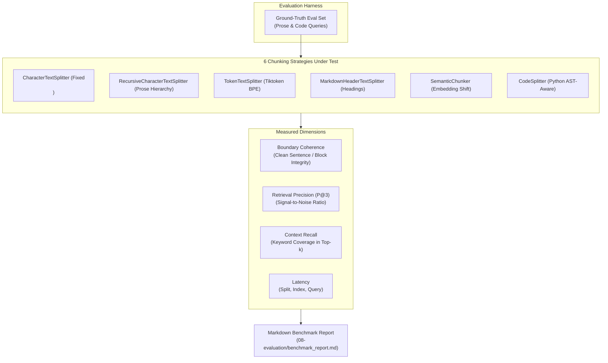

# RAG & Chunking Evaluation

Part of the [AI Engineering From Scratch](../README.md) learning project — see the root
README for one-time setup (virtual environment, dependencies, API keys).

Evaluating RAG systems requires moving beyond ad-hoc eyeballing to deterministic, automated measurement:
- Did the vector store retrieve the right context chunks independent of the LLM?
- Did the LLM actually synthesize the answer from the retrieved chunks?
- How much does the choice of text chunker impact retrieval precision, latency, and boundary integrity?

This module provides two complementary evaluation tools:
1. **Layered RAG Evaluation (`01_rag_eval.py`)**:
   Splits evaluation into **retrieval quality** and **answer generation quality** using ground-truth keyword sets. Isolates whether a failure was caused by search or by model hallucinations.
2. **Chunking Strategy Benchmark (`02_benchmark_chunking.py`)**:
   Automated benchmark harness scoring all 6 chunking strategies from `01-chunking-methods/` across boundary coherence, retrieval precision (P@k), context recall, and latency.



---

## Files in this module

| File | Type | What it demonstrates |
| --- | --- | --- |
| `01_rag_eval.py` | RAG Eval Harness | Separates retrieval scoring from generation scoring using expected keyword validation. |
| `02_benchmark_chunking.py` | Strategy Benchmark | Head-to-head comparison of 6 chunking strategies on boundary coherence, precision, recall, and latency. |
| `benchmark_report.md` | Benchmark Report | Generated Markdown summary and trade-off analysis exported by `02_benchmark_chunking.py`. |

---

## Chunking Strategy Benchmark Results

Tested on multi-document corpus (`sample.txt`, `sample.md`, `sample_code.py`) with top-k=3 retrieval:

| Strategy | Paradigm | Chunks | Avg Size | Boundary Coherence | Retrieval Precision (P@3) | Context Recall | Index Time | Query Time | Best Use Case |
| --- | --- | ---: | ---: | ---: | ---: | ---: | ---: | ---: | --- |
| `CharacterTextSplitter` | Fixed Separator | 13 | 392 chars | 84.6% | 61.1% | 100.0% | ~3100 ms | ~48 ms | Structured double-newline text |
| `RecursiveCharacterTextSplitter` | Hierarchical Prose | 15 | 346 chars | 60.0% | 61.1% | 95.8% | ~950 ms | ~35 ms | General unstructured prose |
| `TokenTextSplitter` | BPE Token Counting | 17 | 350 chars | 5.9% | 66.7% | 88.9% | ~1890 ms | ~62 ms | Hard LLM context limits |
| `MarkdownHeaderTextSplitter` | Structural Headings | 13 | 390 chars | 84.6% | 61.1% | 100.0% | ~1600 ms | ~167 ms | Documentation & technical specs |
| `SemanticChunker` | Semantic Distance | 10 | 512 chars | 100.0% | 38.9% | 88.9% | ~3500 ms | ~88 ms | Dense prose with thematic shifts |
| `CodeSplitter (Python)` | Language AST-Aware | 15 | 346 chars | 60.0% | 61.1% | 95.8% | ~1700 ms | ~97 ms | Source code repositories |

---

## Metric Explanations

1. **Boundary Coherence**:
   Measures whether chunks maintain syntactic and semantic completeness. Scores the proportion of chunks that begin at clean sentence/declaration starts and terminate with appropriate sentence punctuation or block closure delimiters, rather than severing sentences or tokens mid-clause.
2. **Retrieval Precision (P@k)**:
   The proportion of retrieved top-k chunks that contain ground-truth keywords for the query. Higher precision means less irrelevant noise fed to the LLM.
3. **Context Recall (Hit Rate)**:
   The percentage of expected ground-truth facts and keywords captured across the combined retrieved chunks. Ensures the model receives the facts necessary to answer.
4. **Chunking & Index Latency**:
   Execution time to split documents and embed chunks into Chroma vector stores.

---

## Running the Examples

Make sure your virtual environment is active:

```powershell
venv\Scripts\Activate.ps1
```

### 1. Run the RAG Evaluation Harness
Checks retrieval vs. answer generation accuracy:

```powershell
python 08-evaluation/01_rag_eval.py
```

### 2. Run the Chunking Strategies Benchmark
Benchmarks all 6 chunkers and outputs the comparison table and `benchmark_report.md`:

```powershell
python 08-evaluation/02_benchmark_chunking.py
```
