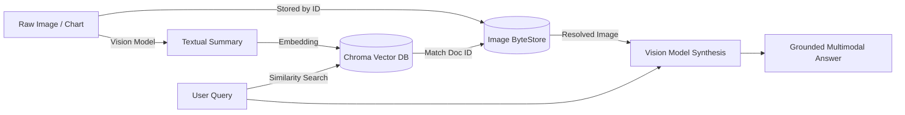

# Multimodal RAG

Part of the [AI Engineering From Scratch](../README.md) learning project — see the root
README for one-time setup (virtual environment, dependencies, API keys).

Technical documentation, financial earnings, and scientific reports contain crucial
information locked inside visual assets: architecture flowcharts, quarterly bar charts,
and UI mockups. Standard text splitters discard or ignore this content.

**Multimodal RAG** bridges this gap using three fundamental patterns:

1. **Vision-Driven Context Extraction (Image Summarization)**:
   Vision models inspect images and transcribe them into detailed, semantic summaries
   capturing diagram topologies, axis metrics, and quantitative relationships.
2. **Multi-Vector Retrieval**:
   Image summaries are stored as searchable dense vectors in Chroma, while linking
   back to the original raw images stored in key-value byte storage.
3. **Multimodal Answer Generation**:
   The user query retrieves the raw image and related text passages, feeding both
   into a vision LLM to synthesize an answer referencing the visual evidence.



## Files in this module

| File | Concept | What it demonstrates |
| --- | --- | --- |
| `01_image_summarization_and_embedding.py` | Visual Extraction & Indexing | Extracts semantic summaries from images and indexes them in Chroma with metadata links back to source files. |
| `02_multimodal_rag_pipeline.py` | Multimodal QA Pipeline | Retrieves both text chunks and images, passing visual context directly to the generation model. |
| `03_multi_vector_retriever.py` | LangChain MultiVectorRetriever | Links summary embeddings in Chroma to raw image byte data stored in an `InMemoryByteStore`. |

## Running it

Make sure your virtual environment is active:

```powershell
python 13-multimodal/01_image_summarization_and_embedding.py
```
