# Tool-Use Patterns in LangGraph

Part of the [AI Engineering From Scratch](../README.md) learning project — see the root
README for one-time setup (virtual environment, dependencies, API keys).

While naive agents execute one tool at a time, production agentic architectures
require advanced orchestration patterns:

1. **Parallel Tool Calling**: When a user's intent spans multiple data sources (e.g. checking weather in 3 cities or fetching metrics for 2 services), tools should execute concurrently rather than sequentially in separate round-trips.
2. **Tool Chaining**: Feeding the structured output of Tool A directly into Tool B deterministically or through state nodes, minimizing LLM hallucination and reducing token cost.
3. **Error Recovery**: Intercepting tool exceptions (missing params, API limits, bad formatting), returning diagnostic feedback to the model, and automatically retrying with corrected parameters without crashing the agent loop.

```mermaid
flowchart TD
    subgraph Parallel Tool Calling
        M1[Model Request] -->|tool_call_1| T1[Tool A: Stock Price]
        M1 -->|tool_call_2| T2[Tool B: Weather]
        T1 --> AGG[Aggregate ToolMessages]
        T2 --> AGG
        AGG --> M2[Model Final Synthesis]
    end

    subgraph Tool Chaining
        TC1[Tool A: User Profile] -->|account_id| TC2[Tool B: Transactions]
        TC2 -->|total_volume| TC3[Tool C: Risk Assessment]
        TC3 --> TCS[Executive Summary]
    end

    subgraph Error Recovery Loop
        ER1[Model Invokes Tool] -->|Bad Arguments| ER2[Tool Traps Exception]
        ER2 -->|Diagnostic Feedback| ER3[ToolMessage with Format Guide]
        ER3 -->|Self-Correction| ER1
    end
```



---

## Files in this module

| File | Pattern | Key Concept |
| --- | --- | --- |
| `01_parallel_tool_calls.py` | Parallel Tool Calls | Concurrently dispatches multiple `tool_calls` in a single `AIMessage` using `ToolNode` (Ollama or local fallback). |
| `01_parallel_tool_calls_qorebit.py` | Parallel Tool Calls | Hosted twin using Qorebit (`openai/gpt-4o`) with native parallel tool dispatch. |
| `02_tool_chaining.py` | Tool Chaining | Feeds Tool A's output directly into Tool B across deterministic state nodes without extra LLM overhead. |
| `03_error_recovery.py` | Error Recovery & Retry | Traps tool execution exceptions into `ToolMessage` feedback, auto-correcting inputs and retrying. |

---

## Running it

Make sure your virtual environment is active:

```powershell
# 1. Parallel tool calls (Ollama or local fallback)
python 14-tool-use-patterns/01_parallel_tool_calls.py

# 2. Parallel tool calls (Qorebit - requires QOREBIT_API_KEY in .env)
python 14-tool-use-patterns/01_parallel_tool_calls_qorebit.py

# 3. Tool chaining pipeline
python 14-tool-use-patterns/02_tool_chaining.py

# 4. Error recovery and self-healing loop
python 14-tool-use-patterns/03_error_recovery.py
```

---

## Notes / gotchas

- **Concurrent Execution in ToolNode**: LangGraph's `ToolNode` automatically inspects `AIMessage.tool_calls` and executes all requested tools in parallel threads, returning a list of `ToolMessage`s matched by `tool_call_id`.
- **Avoiding LLM Ping-Pong in Tool Chaining**: In `02_tool_chaining.py`, passing data from Tool 1 to Tool 2 directly in Python state rather than asking the LLM to format the parameters avoids hallucination and saves significant token latency.
- **Diagnostic Feedback for Self-Correction**: When catching tool errors in `03_error_recovery.py`, the error string sent back to the LLM must be actionable (e.g. specifying the required `YYYY-MM-DD` date format) rather than a generic stack trace.
