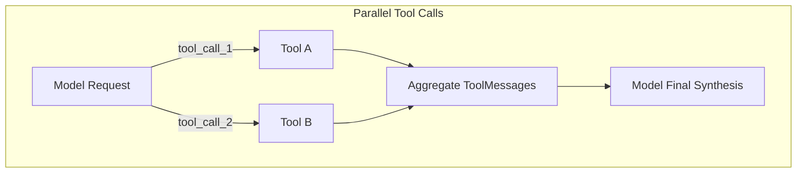

# Tool-Use Patterns in LangGraph

Part of the [AI Engineering From Scratch](../README.md) learning project — see the root
README for one-time setup (virtual environment, dependencies, API keys).

While standard tool calling executes one tool at a time, production agentic architectures
require advanced orchestration patterns:

1. **Parallel Tool Calling**: When a user's intent spans multiple data sources (e.g. checking weather in 3 cities or fetching metrics for 2 services), tools should execute concurrently rather than sequentially in separate turns.
2. **Tool Chaining**: Feeding the structured output of Tool A directly into Tool B deterministically or through graph nodes, minimizing LLM hallucination and reducing token cost.
3. **Error Recovery**: Intercepting tool exceptions (missing params, API limits, bad formatting), returning diagnostic feedback to the model, and automatically retrying with corrected parameters without crashing the agent loop.



## Files in this module

| File | Pattern | Key Concept |
| --- | --- | --- |
| `01_parallel_tool_calls.py` | Parallel Tool Calls | Concurrently dispatches multiple `tool_calls` in a single `AIMessage` using `ToolNode`. |
| `02_tool_chaining.py` | Tool Chaining | Feeds Tool A's output into Tool B across deterministic state nodes without extra LLM overhead. |
| `03_error_recovery.py` | Error Recovery & Retry | Traps tool execution exceptions into `ToolMessage` feedback, auto-correcting inputs and retrying. |

## Running it

```powershell
python 14-tool-use-patterns/01_parallel_tool_calls.py
```
