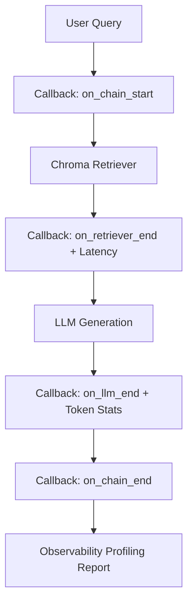

# Observability & Tracing

Part of the [AI Engineering From Scratch](../README.md) learning project — see the root
README for one-time setup (virtual environment, dependencies, API keys).

Deploying LLMs and RAG pipelines to production requires answering crucial questions:
- *Why is a specific request taking 4 seconds? (Is it embedding, vector search, or generation?)*
- *What exact prompt with augmented chunks was dispatched to the LLM?*
- *How many prompt and completion tokens were spent?*
- *Which tool or agent step caused a failure?*

**AI Observability** provides transparency across three standard patterns:

1. **Custom Callback Handlers**:
   Directly hooks into LangChain's event bus (`BaseCallbackHandler`) to measure component latencies, log inputs/outputs, and print profiling flame-graphs without external dependencies.
2. **OpenTelemetry (OTEL)**:
   Emits vendor-neutral, distributed tracing spans adhering to the Generative AI Semantic Conventions.
3. **LangSmith Tracing**:
   Deep trace visualization, run tree analysis, and feedback tagging.



## Files in this module

| File | Framework | What it demonstrates |
| --- | --- | --- |
| `01_custom_callbacks_tracing.py` | Native Callbacks | Zero-cloud, local profiling tracker capturing step latencies and flame-graph reports. |
| `02_opentelemetry_tracing.py` | OpenTelemetry | OpenTelemetry tracer instrumenting RAG operations with Generative AI semantic spans. |
| `03_langsmith_tracing.py` | LangSmith | Production tracing with run tags, project namespaces, and metadata tracking. |

## Running it

Make sure your virtual environment is active:

```powershell
python 15-observability/01_custom_callbacks_tracing.py
```
