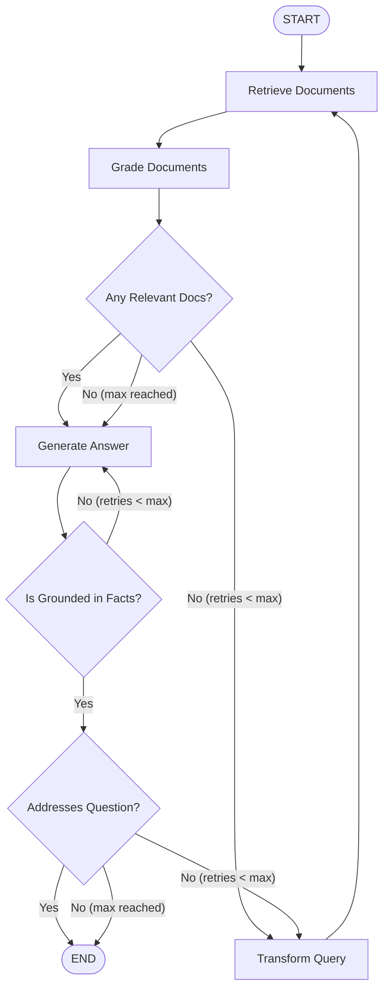

# Self-RAG & Corrective RAG (CRAG)

Part of the [AI Engineering From Scratch](../README.md) learning project — see the root
README for one-time setup (virtual environment, dependencies, API keys).

Standard RAG operates in an open loop: retrieve documents once, inject them into a prompt,
and generate. If retrieval fails or returns off-topic information, the LLM hallucinates or
fails silently.

**Self-RAG (Self-Reflective RAG)** and **Corrective RAG (CRAG)** turn retrieval-augmented
generation into a self-evaluating state machine using **LangGraph**:

1. **Retrieve**: Fetch candidate chunks from the Chroma vector store.
2. **Grade Documents**: An evaluation node reviews each retrieved chunk for question relevance, discarding off-topic noise.
3. **Decide / Conditional Routing**:
   - If relevant documents exist -> route to **Generate**.
   - If all documents are irrelevant -> route to **Transform Query** to rewrite the prompt.
4. **Transform Query**: Reformulates the question to improve semantic/keyword retrieval and routes back to **Retrieve**.
5. **Generate**: Answers the query using strictly validated, relevant context.
6. **Self-Reflection (Hallucination & Relevance Graders)**:
   - Verifies whether the answer is grounded in retrieved facts (hallucination check).
   - Verifies whether the answer actually addresses the user's question.
   - Triggers regeneration or query reformulation if quality criteria fail.
7. **Loop Guard**: Caps retries (`MAX_RETRIES`) so the graph is guaranteed to terminate.



---

## Files in this module

| File | LLM Backend | What it demonstrates |
| --- | --- | --- |
| `01_self_rag_local.py` | `google/flan-t5-base` (local CPU) | Zero-API-key local Self-RAG state graph with document grading, query rewriting, and loop guard. |
| `02_self_rag_ollama.py` | Ollama (`llama3.2:3b`) | Production-style Self-RAG with Pydantic structured output for document relevance, hallucination checks, and answer evaluation. |
| `03_self_rag_qorebit.py` | Qorebit (`openai/gpt-4o`) | Hosted twin running GPT-4o with full corrective RAG loop and custom headers. |

---

## Running it

Make sure your virtual environment is activated:

```powershell
# 1. Run local version (free, no API keys, CPU-friendly):
python 17-self-rag/01_self_rag_local.py

# 2. Run Ollama version (requires Ollama running locally with llama3.2:3b):
python 17-self-rag/02_self_rag_ollama.py

# 3. Run Qorebit twin (requires QOREBIT_API_KEY in .env):
python 17-self-rag/03_self_rag_qorebit.py
```

---

## Notes / gotchas

- **Loop Protection is Mandatory**: Without `MAX_RETRIES` tracking in `GraphState`, an impossible question or poor document collection can bounce indefinitely between `grade_documents` and `transform_query`.
- **Structured Outputs with Small Models**: `02_self_rag_ollama.py` and `03_self_rag_qorebit.py` use Pydantic models via `.with_structured_output()`. Instruction-tuned models like `llama3.2:3b` and `gpt-4o` follow schemas cleanly, whereas small sequence-to-sequence models like `flan-t5-base` in `01_self_rag_local.py` are better served by binary string parsing (`yes`/`no`).
- **Vector Store Isolation**: Each file creates its own persistent subfolder under `db/` (`db/self_rag_local/`, `db/self_rag_ollama/`, `db/self_rag_qorebit/`) so running one does not interfere with the others.
