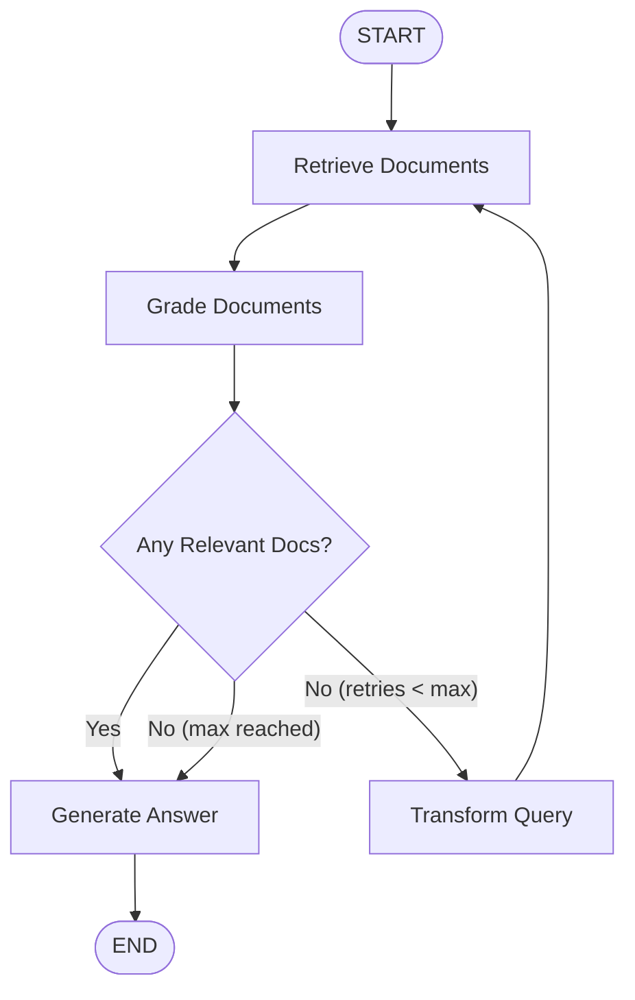

# Self-RAG & Corrective RAG (CRAG)

Part of the [AI Engineering From Scratch](../README.md) learning project — see the root
README for one-time setup (virtual environment, dependencies, API keys).

Standard RAG operates in an open loop: retrieve documents once, inject them into a prompt,
and generate. If retrieval fails or returns off-topic information, the LLM hallucinates or
fails silently.

**Self-RAG (Self-Reflective RAG)** and **Corrective RAG (CRAG)** turn retrieval-augmented
generation into a closed-loop state machine using **LangGraph**:
1. **Retrieve**: Fetch top candidate chunks from the vector store.
2. **Grade Documents**: An evaluation node reviews each retrieved chunk for question relevance.
3. **Decide / Conditional Edge**:
   - If relevant documents exist -> route to **Generate**.
   - If documents are irrelevant -> route to **Transform Query** to rewrite the prompt.
4. **Transform Query**: Reformulates the question to improve semantic/keyword retrieval and routes back to **Retrieve**.
5. **Loop Protection**: Tracks retry iterations to guarantee graph termination.
6. **Generate**: Answers the query using strictly validated, relevant context.



## Files in this module

| File | LLM Backend | What it demonstrates |
| --- | --- | --- |
| `01_self_rag_local.py` | `google/flan-t5-base` (local CPU) | Zero-API-key local Self-RAG state graph with document grading, query rewriting, and loop guard. |
| `02_self_rag_ollama.py` | Ollama (`llama3.2:3b`) | Production-style Self-RAG using structured Pydantic grading and hallucination verification. |
| `03_self_rag_qorebit.py` | Qorebit (`openai/gpt-4o`) | Hosted twin running GPT-4o with full corrective RAG loop. |

## Running it

Make sure your virtual environment is active:

```powershell
python 17-self-rag/01_self_rag_local.py
```
