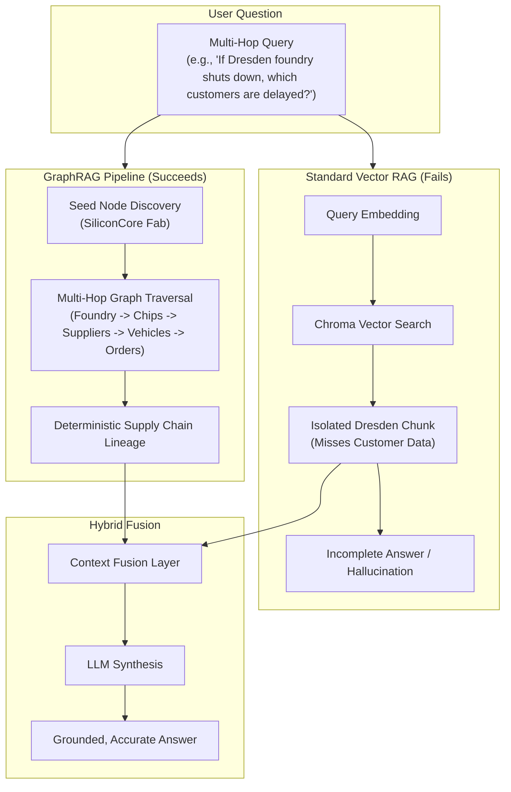

# Module 01: RAG and Advanced GraphRAG

Part of the **AI Engineer Master Course Resource Pack** — accompanying the [AI Engineer Master Course](https://youtu.be/BXY7mAFN21k).

---

## Overview

Standard Retrieval-Augmented Generation (Vector RAG) converts text documents into isolated vector embeddings. While this works well for semantic matching against single paragraphs, it fails when an answer requires **multi-hop reasoning** — connecting disparate facts across separated documents.

**GraphRAG** solves this limitation by mapping entities into a knowledge graph. By traversing explicit relationships (edges) between concept nodes, GraphRAG extracts deterministic, multi-hop contextual chains that standard semantic search completely misses.



---

## Files in this Module

| File | Type | What it Demonstrates |
| --- | --- | --- |
| `01_naive_vs_advanced_rag.py` | Head-to-Head Comparison | Direct comparison demonstrating why vector search misses multi-hop queries and how graph traversal resolves them. |
| `02_entity_relation_extraction.py` | Extraction Pipeline | Converts unstructured prose into structured Pydantic entity nodes and typed relationship triples (`(Subject, Predicate, Object)`). |
| `03_graphrag_in_memory.py` | In-Memory Graph Engine | Full GraphRAG pipeline in pure Python using `NetworkX` and `MiniLM` embeddings without external database infrastructure. |
| `04_hybrid_graph_vector_rag.py` | Production Hybrid RAG | Merges dense vector retrieval (narrative descriptions) with graph traversal (structural lineage) for optimal RAG accuracy. |

---

## Running the Examples

Make sure your virtual environment is active:

```powershell
venv\Scripts\Activate.ps1
```

### 1. Run the Naive vs. GraphRAG Comparison
```powershell
python ai-engineer/01-rag-and-graphrag/01_naive_vs_advanced_rag.py
```

### 2. Run Entity & Relation Extraction
```powershell
python ai-engineer/01-rag-and-graphrag/02_entity_relation_extraction.py
```

### 3. Run In-Memory GraphRAG
```powershell
python ai-engineer/01-rag-and-graphrag/03_graphrag_in_memory.py
```

### 4. Run Hybrid Graph + Vector RAG
```powershell
python ai-engineer/01-rag-and-graphrag/04_hybrid_graph_vector_rag.py
```
