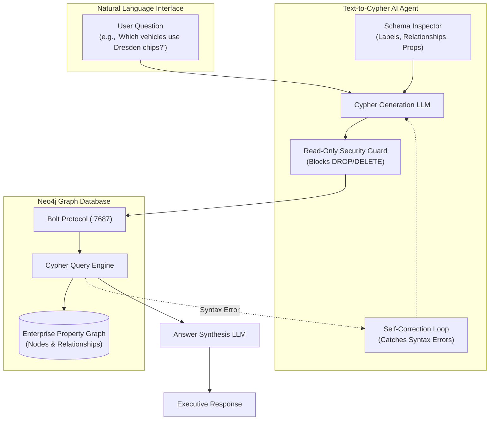

# Module 02: Neo4j Knowledge Graphs & Cypher

Part of the **AI Engineer Master Course Resource Pack** — accompanying the [AI Engineer Master Course](https://youtu.be/BXY7mAFN21k).

---

## Overview

While in-memory graph tools like `NetworkX` are excellent for prototyping, production GraphRAG architectures require enterprise graph databases capable of scaling to millions of nodes with indexed ACID transactions.

**Neo4j** is the leading property graph database. This module demonstrates how AI Engineers connect to Neo4j, apply schema constraints, execute idiomatic Cypher queries, bulk-ingest knowledge graphs, and build autonomous **Text-to-Cypher agents**.



---

## Files in this Module

| File | Type | What it Demonstrates |
| --- | --- | --- |
| `01_neo4j_connection_and_setup.py` | Connection & Schema | Driver initialization, authentication, health checks, and uniqueness constraints (with simulated fallback). |
| `02_cypher_query_patterns.py` | Query Patterns | Idiomatic Cypher: idempotent `MERGE`, property filtering, variable-length paths (`[*1..5]`), and centrality aggregations. |
| `03_graph_schema_construction.py` | Bulk Ingestion Pipeline | Ingesting structured graph datasets into Neo4j using high-performance parameterized `UNWIND $batch` transactions. |
| `04_text_to_cypher_agent.py` | Autonomous Agent | Natural language to Cypher translation agent with schema awareness, read-only safety validation, and error self-correction. |

---

## Essential Cypher Patterns Cheatsheet

```cypher
// 1. Idempotent Node Creation
MERGE (f:Foundry {name: 'SiliconCore Fab'})
ON CREATE SET f.location = 'Dresden', f.created_at = timestamp();

// 2. Relationship Creation with Properties
MATCH (f:Foundry {name: 'SiliconCore Fab'}), (c:Microchip {name: 'SC-9901'})
MERGE (f)-[r:MANUFACTURES]->(c)
ON CREATE SET r.yield_rate = 0.985;

// 3. Multi-Hop Variable-Length Path Traversal
MATCH path = (start:Foundry {name: 'SiliconCore Fab'})-[*1..5]->(target:Customer)
RETURN [n IN nodes(path) | n.name] AS supply_chain, length(path) AS hops;

// 4. Bottleneck & Degree Centrality Detection
MATCH (n)-[r]-()
RETURN labels(n)[0] AS type, n.name AS entity, count(r) AS degree
ORDER BY degree DESC LIMIT 5;
```

---

## Running the Examples

Make sure your virtual environment is active:

```powershell
venv\Scripts\Activate.ps1
```

### 1. Connection & Schema Setup
```powershell
python ai-engineer/02-neo4j-knowledge-graphs/01_neo4j_connection_and_setup.py
```

### 2. Idiomatic Cypher Patterns
```powershell
python ai-engineer/02-neo4j-knowledge-graphs/02_cypher_query_patterns.py
```

### 3. Bulk Ingestion Pipeline
```powershell
python ai-engineer/02-neo4j-knowledge-graphs/03_graph_schema_construction.py
```

### 4. Text-to-Cypher Agent
```powershell
python ai-engineer/02-neo4j-knowledge-graphs/04_text_to_cypher_agent.py
```

---

## Local Neo4j Setup (Optional Docker)

To run against a local Neo4j container:

```powershell
docker compose -f ai-engineer/docker-compose.yml up -d
```
Access the Neo4j Browser at: [http://localhost:7474](http://localhost:7474) (Username: `neo4j`, Password: `aiengineering_password`).
*(Note: Every script runs with automatic simulated fallback if Docker is not active).*
