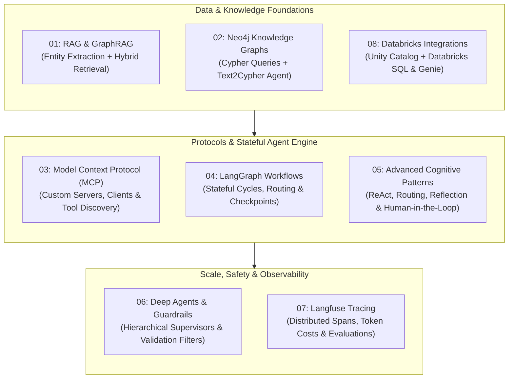

# AI Engineer Master Course — Complete Resource Pack & Implementation Roadmap

> **Companion Resource Pack** for the [AI Engineer Master Course](https://youtu.be/BXY7mAFN21k)  
> Covering modern, production-grade AI engineering architectures: GraphRAG, Neo4j, MCP, LangGraph, Advanced Cognitive Patterns, Deep Multi-Agent Systems, Langfuse LLMOps, and Databricks Enterprise Integrations.

---

## 1. High-Level Architecture & Curriculum Map



---

## 2. Directory & Module Structure

The `ai-engineer/` directory will be organized into 8 self-contained modules, each running standalone with clean offline fallbacks and production cloud integration options:

```
ai-engineer/
├── README.md                                 # Master documentation, architecture diagrams & setup
├── ROADMAP.md                                # This phased execution plan & curriculum spec
├── requirements.txt                          # Unified dependencies (LangGraph, Neo4j, MCP, Langfuse, Databricks)
├── docker-compose.yml                        # One-command spin-up for local Neo4j & Langfuse
├── .env.example                              # Environment credentials template
├── data/                                     # Shared sample datasets (articles, schemas, tables)
│   ├── supply_chain_knowledge.json           # Relational & entity data for GraphRAG
│   ├── enterprise_policies.txt               # Document corpus for RAG & guardrails
│   └── sales_telemetry.csv                   # Structured analytical data for Databricks SQL demos
│
├── 01-rag-and-graphrag/                      # Module 1: Graph-Augmented Retrieval
│   ├── README.md
│   ├── 01_naive_vs_advanced_rag.py           # Dense vector similarity vs. multi-hop Graph retrieval
│   ├── 02_entity_relation_extraction.py      # Extracting (Subject, Predicate, Object) triples using LLMs
│   ├── 03_graphrag_in_memory.py              # In-memory graph traversal with NetworkX
│   └── 04_hybrid_graph_vector_rag.py         # Fusing vector similarity search with graph walk context
│
├── 02-neo4j-knowledge-graphs/                # Module 2: Enterprise Graph Databases & Cypher
│   ├── README.md
│   ├── 01_neo4j_connection_and_setup.py      # Connecting to Neo4j (Docker/AuraDB) via official Python driver
│   ├── 02_cypher_query_patterns.py           # Programmatic Cypher: MATCH, MERGE, aggregations, relationship creation
│   ├── 03_graph_schema_construction.py       # Auto-building an enterprise knowledge graph from document text
│   └── 04_text_to_cypher_agent.py            # Natural language to Cypher agent with schema inspection & self-healing
│
├── 03-mcp-servers-and-clients/               # Module 3: Model Context Protocol (MCP)
│   ├── README.md
│   ├── 01_mcp_server_custom_tools.py         # Authoring a standalone MCP Server exposing tools & resources
│   ├── 02_mcp_client_integration.py          # Authoring an MCP Client connecting over stdio / SSE transports
│   └── 03_mcp_langchain_agent.py             # Integrating dynamic MCP tool discovery into LangChain/LangGraph agents
│
├── 04-langgraph-workflows/                   # Module 4: Stateful Multi-Actor Graphs
│   ├── README.md
│   ├── 01_stateful_graph_basics.py           # StateGraph, TypedDict/Pydantic schemas, nodes, and linear edges
│   ├── 02_conditional_routing_and_cycles.py  # Branching conditional edges, evaluation gates, and iterative loops
│   └── 03_checkpointing_and_persistence.py   # SqliteSaver persistence, session resumption, and time-travel debugging
│
├── 05-agent-patterns/                        # Module 5: Cognitive Decision Patterns
│   ├── README.md
│   ├── 01_react_pattern.py                   # ReAct (Thought -> Action -> Observation) from scratch in LangGraph
│   ├── 02_semantic_routing.py                # Intent classification & routing to domain-specific agent nodes
│   ├── 03_reflection_and_self_critique.py    # Actor-Critic reflection loop for automated output refinement
│   └── 04_human_in_the_loop.py               # Graph interrupts, human review/approval, and dynamic state modification
│
├── 06-deep-agents-and-guardrails/            # Module 6: Hierarchical Systems & Production Safety
│   ├── README.md
│   ├── 01_supervisor_multi_agent.py          # Orchestrator supervisor routing to specialized worker subgraphs
│   ├── 02_deep_researcher_agent.py           # Recursive plan-and-execute multi-step research agent
│   └── 03_input_output_guardrails.py         # Prompt injection mitigation, Pydantic validation, and self-correction
│
├── 07-observability-langfuse/                # Module 7: LLMOps & Distributed Tracing
│   ├── README.md
│   ├── 01_langfuse_tracing_setup.py          # Langfuse callback handler integration with LangGraph
│   ├── 02_distributed_traces_and_spans.py    # Nested trace spans, prompt version tracking, latency & token costs
│   └── 03_eval_and_feedback_logging.py       # Automated LLM-as-a-judge scores, user feedback, and dataset curation
│
└── 08-databricks-integrations/               # Module 8: Lakehouse & Enterprise AI Analytics
    ├── README.md
    ├── 01_databricks_sql_agent.py            # Natural language SQL agent querying Databricks Lakehouse tables
    ├── 02_databricks_genie_integration.py    # Integrating conversational data analytics via Databricks Genie spaces
    └── 03_enterprise_lakehouse_rag.py        # Hybrid RAG fusing Unity Catalog structured data with vector search
```

---

## 3. Detailed Module Breakdown & What Each Demonstrates

### Module 1: RAG and Advanced GraphRAG
- **Problem Solved**: Standard vector similarity retrieves isolated text fragments, failing when queries require connecting facts across distant documents.
- **Implementations**:
  - `01_naive_vs_advanced_rag.py`: Side-by-side comparison showing where vector-only RAG misses relational queries.
  - `02_entity_relation_extraction.py`: Using structured extraction to parse documents into entities (Nodes) and typed relationships (Edges).
  - `03_graphrag_in_memory.py`: Building an in-memory knowledge graph using `NetworkX` with multi-hop neighbor search.
  - `04_hybrid_graph_vector_rag.py`: Fusing dense vector retrieval with graph neighbor context into a unified augmented prompt.

### Module 2: Neo4j Knowledge Graphs and Cypher
- **Problem Solved**: Scaling knowledge graphs to millions of nodes with enterprise-grade graph querying.
- **Implementations**:
  - `01_neo4j_connection_and_setup.py`: Environment setup, authentication, and index creation (with offline mock fallback).
  - `02_cypher_query_patterns.py`: Idiomatic Cypher for entity creation, pattern matching, graph aggregation, and pathfinding.
  - `03_graph_schema_construction.py`: Pipeline parsing unstructured enterprise documents into a populated Neo4j graph.
  - `04_text_to_cypher_agent.py`: Agent dynamically inspecting the Neo4j schema, generating Cypher queries, validating syntax, and correcting runtime errors.

### Module 3: MCP (Model Context Protocol) Servers and Clients
- **Problem Solved**: Standardizing how AI models connect to local tools, enterprise databases, and external resources without vendor lock-in.
- **Implementations**:
  - `01_mcp_server_custom_tools.py`: Python MCP server implementing the protocol specification exposing tools, prompts, and resources.
  - `02_mcp_client_integration.py`: Lightweight MCP client managing stdio sub-processes and JSON-RPC handshakes.
  - `03_mcp_langchain_agent.py`: Converting discovered MCP server tools directly into LangChain `BaseTool`s and executing them inside a LangGraph agent.

### Module 4: LangChain & LangGraph Agent Workflows
- **Problem Solved**: Moving from rigid, linear chains to robust, cyclic, stateful agent graphs with full execution recovery.
- **Implementations**:
  - `01_stateful_graph_basics.py`: Defining immutable state schemas, node functions, and deterministic state transitions.
  - `02_conditional_routing_and_cycles.py`: Dynamic conditional edges that route execution based on tool output or model confidence.
  - `03_checkpointing_and_persistence.py`: Long-term session state storage with `SqliteSaver`, thread IDs, and time-travel rewind.

### Module 5: ReAct, Routing, Reflection, and Human-in-the-Loop
- **Problem Solved**: Enabling agents to reason step-by-step, critique their own errors, and safely seek human authorization before taking destructive actions.
- **Implementations**:
  - `01_react_pattern.py`: Pure LangGraph implementation of the ReAct (Thought-Action-Observation) loop with custom tool nodes.
  - `02_semantic_routing.py`: Fast zero-shot intent router directing queries to specialized sub-agents (e.g. Sales, Tech Support, Billing).
  - `03_reflection_and_self_critique.py`: Two-node cyclic graph where an Actor generates an initial draft and a Critic provides structured revision feedback until quality thresholds pass.
  - `04_human_in_the_loop.py`: Graph interrupt (`interrupt_before=["execute_action"]`) halting execution for human approval and state injection.

### Module 6: Deep Agents, Guardrails, and Multi-Agent Systems
- **Problem Solved**: Managing complexity in enterprise multi-agent teams while preventing prompt injections and hallucinations.
- **Implementations**:
  - `01_supervisor_multi_agent.py`: Central supervisor agent orchestrating a team of specialized worker agents with clear responsibilities.
  - `02_deep_researcher_agent.py`: Plan-and-execute agent that generates sub-tasks, delegates research, aggregates findings, and synthesizes a final brief.
  - `03_input_output_guardrails.py`: Defense-in-depth security: prompt injection detection, Pydantic schema validation, and automatic regeneration on safety violations.

### Module 7: Langfuse Tracing and Observability
- **Problem Solved**: Real-time visibility into production multi-agent systems, identifying bottleneck latencies, token consumption, and model regressions.
- **Implementations**:
  - `01_langfuse_tracing_setup.py`: Zero-code-change callback handler instrumenting LangChain and LangGraph runs into Langfuse.
  - `02_distributed_traces_and_spans.py`: Hierarchical execution visualization showing prompt inputs, tool calls, model latency, and token cost breakdown.
  - `03_eval_and_feedback_logging.py`: Collecting user scores, programmatic evaluations (faithfulness, answer relevance), and curating test datasets.

### Module 8: Databricks SQL, Genie, and Enterprise AI Integrations
- **Problem Solved**: Unlocking enterprise Lakehouse analytics, allowing AI agents to query governed Unity Catalog tables and leverage Databricks Genie.
- **Implementations**:
  - `01_databricks_sql_agent.py`: Natural language text-to-SQL agent querying Databricks SQL Warehouses with schema context and query safety checks.
  - `02_databricks_genie_integration.py`: Interacting with Databricks Genie spaces to perform conversational data exploration over enterprise metrics.
  - `03_enterprise_lakehouse_rag.py`: Hybrid intelligence: combining structured SQL aggregation results with unstructured vector context.

---

## 4. Proposed Phased Implementation Plan

To ensure thorough testing, maintainable commits, and zero breakage, the implementation will be executed in **4 organized phases**:

| Phase | Modules Covered | Deliverables & Focus |
| --- | --- | --- |
| **Phase 1** | Module 01 (GraphRAG) + Module 02 (Neo4j) | Foundational Knowledge Graphs, Entity Extraction, Cypher Agent, In-Memory & Neo4j Hybrid RAG. |
| **Phase 2** | Module 03 (MCP) + Module 04 (LangGraph) | Model Context Protocol servers/clients, stateful graphs, routing cycles, and SQLite persistence. |
| **Phase 3** | Module 05 (Patterns) + Module 06 (Deep Agents) | ReAct, Reflection, Human-in-the-Loop approval, Multi-agent Supervisor, and Production Guardrails. |
| **Phase 4** | Module 07 (Langfuse) + Module 08 (Databricks) | LLMOps tracing, token cost accounting, Databricks SQL Warehouse agent, and Genie conversational analytics. |

---

## 5. Technology Stack & Prerequisites

- **Python Runtime**: Python 3.11+ / 3.12 / 3.13
- **Core Agent Orchestration**: `langgraph`, `langchain`, `langchain-core`, `langchain-community`
- **Graph Databases**: `neo4j` (Python driver), `networkx` (in-memory graphs)
- **Protocols & Integrations**: `mcp` (Model Context Protocol SDK), `databricks-sql-connector`, `databricks-sdk`
- **Observability & Guardrails**: `langfuse`, `pydantic` v2
- **Vector Search & Embeddings**: `langchain-chroma`, `sentence-transformers/all-MiniLM-L6-v2`
- **Local Infrastructure (Optional via Docker Compose)**:
  - Neo4j Community Edition (`bolt://localhost:7687`, HTTP `7474`)
  - Langfuse Local Server (`http://localhost:3000`)
